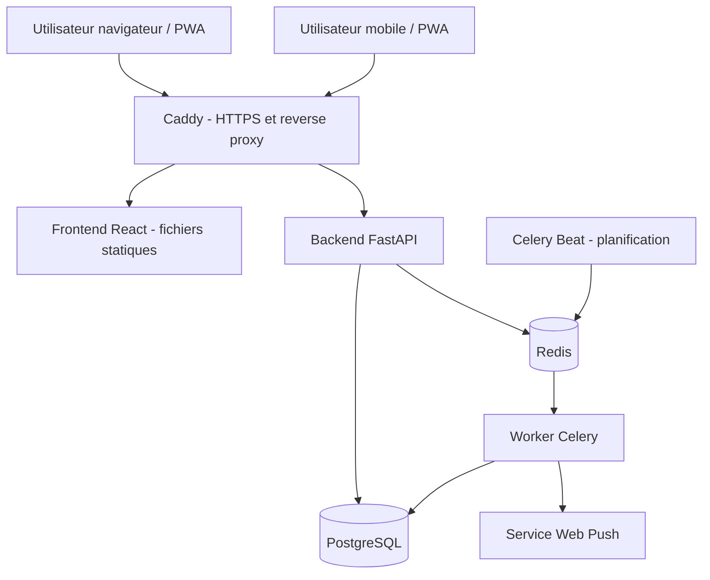

# Architecture technique — Suivi des dépenses

**Version :** 0.1  
**Statut :** Proposition technique à valider  
**Références :** `SPECIFICATIONS.md`, `DATA_MODEL.md`, `ERD.md` v0.3, `API_SPEC.md` v0.2

## 1. Objectifs d'architecture

L'architecture doit rester simple à exploiter pour une application familiale utilisée par deux personnes, tout en garantissant :

- une séparation stricte entre données personnelles et données du foyer ;
- une logique métier testable et indépendante des routes HTTP ;
- des calculs financiers déterministes et historisés ;
- une expérience PWA responsive, avec consultation hors ligne en lecture seule ;
- une maintenance et un déploiement réalisables avec Docker Compose ;
- une évolution possible sans introduire prématurément des microservices.

**Décision structurante :** architecture monolithique modulaire. Le backend est une seule application FastAPI, organisée par domaines fonctionnels. Le frontend est une application React indépendante qui consomme l'API REST.

## 2. Vue d'ensemble



Le navigateur charge le frontend depuis le même domaine que l'API. Caddy route les requêtes applicatives vers les ressources statiques ou vers FastAPI. Cette origine unique simplifie les cookies de session et la politique CORS.

## 3. Stack technique

| Couche | Technologie | Responsabilité |
|---|---|---|
| Langage backend | Python 3.12+ | Services et API |
| API | FastAPI | HTTP, validation, dépendances |
| Validation | Pydantic v2 | DTO et validation des entrées/sorties |
| ORM | SQLAlchemy 2 | Accès relationnel |
| Migrations | Alembic | Évolution du schéma |
| Base de données | PostgreSQL | Source de vérité |
| Frontend | React + TypeScript + Vite | Interface web |
| UI | Tailwind CSS + shadcn/ui | Design system et composants |
| PWA | vite-plugin-pwa | Manifest, service worker et cache |
| Tâches asynchrones | Celery | Traitements longs et planifiés |
| Broker / cache court | Redis | File de tâches et coordination |
| Reverse proxy | Caddy | HTTPS et routage |
| Conteneurs | Docker Compose | Environnement local et déploiement |
| Tests backend | pytest | Tests unitaires et intégration |
| Tests frontend | Vitest + Testing Library | Tests composants et logique |
| Tests navigateur | Playwright | Parcours utilisateur critiques |

Les versions exactes seront figées dans les fichiers de dépendances et les images Docker. Redis n'est pas la source de vérité : toute donnée métier durable reste dans PostgreSQL.

## 4. Organisation du dépôt

Structure cible :

```text
suivi-depenses/
├── AGENTS.md
├── README.md
├── docs/
│   ├── SPECIFICATIONS.md
│   ├── DATA_MODEL.md
│   ├── ERD.md
│   ├── API_SPEC.md
│   ├── ARCHITECTURE.md
│   ├── ROADMAP.md
│   └── UX_DESIGN.md
├── backend/
│   ├── app/
│   │   ├── main.py
│   │   ├── core/
│   │   ├── api/
│   │   ├── domains/
│   │   ├── infrastructure/
│   │   └── tasks/
│   ├── migrations/
│   ├── tests/
│   ├── pyproject.toml
│   └── Dockerfile
├── frontend/
│   ├── src/
│   │   ├── app/
│   │   ├── components/
│   │   ├── features/
│   │   ├── lib/
│   │   ├── hooks/
│   │   └── styles/
│   ├── public/
│   ├── package.json
│   └── Dockerfile
├── docker/
│   └── Caddyfile
├── docker-compose.yml
└── .env.example
```

Cette structure est une cible. Les fichiers de configuration et les dossiers ne seront créés qu'au démarrage de l'implémentation.

## 5. Backend : monolithe modulaire

### 5.1 Organisation par domaine

`backend/app/domains/` contient les domaines métier :

- `auth` : sessions, invitations, mots de passe ;
- `users` : profil et préférences ;
- `households` : foyers, membres et accès ;
- `transactions` : dépenses, revenus enregistrés et remboursements ;
- `categories` : catégories système et personnalisées ;
- `budgets` : enveloppes et périodes ;
- `recurring` : définitions et occurrences ;
- `incomes` : revenus déclarés servant à la répartition ;
- `allocations` : règles, prévisions et calculs définitifs ;
- `notifications` : notifications et préférences ;
- `imports_exports` : traitement des fichiers ;
- `audit` : journal des actions sensibles.

Un domaine peut contenir ses modèles SQLAlchemy, ses schémas Pydantic, ses repositories, ses services et ses routes. Les dépendances partagées restent dans `core` ou `infrastructure`.

### 5.2 Couches et responsabilités

| Couche | Responsabilité | Ne doit pas faire |
|---|---|---|
| API / routers | HTTP, authentification, validation, codes de réponse | Porter les règles métier |
| Schemas | Contrats d'entrée et de sortie | Accéder à la base |
| Services | Orchestration et règles métier | Dépendre de FastAPI |
| Repositories | Requêtes et persistance | Décider des permissions métier |
| Models | Structure relationnelle et contraintes | Contenir des workflows complexes |
| Tasks | Exécuter les traitements différés | Dupliquer la logique des services |

Les services reçoivent explicitement les dépendances nécessaires (session SQLAlchemy, repositories, horloge, etc.) afin d'être testables.

### 5.3 Transactions SQL

Les opérations multi-étapes sont atomiques :

- paiement d'une occurrence et création de sa transaction ;
- validation d'un import et insertion de ses lignes ;
- finalisation d'un calcul mensuel et création de tous ses snapshots ;
- création ou acceptation d'une invitation et rattachement au foyer.

Le service ouvre et valide la transaction SQL. Les repositories ne font pas de commit implicite.

### 5.4 Authentification et autorisations

- Sessions opaques stockées côté serveur ou représentées par un identifiant aléatoire révocable ; cookie `HttpOnly`, `Secure`, `SameSite` adapté.
- Protection CSRF sur les opérations modifiant l'état.
- Hachage des mots de passe avec Argon2id.
- Invitations à usage unique, avec expiration et jeton stocké sous forme hachée.
- Vérification de l'appartenance au foyer à chaque opération commune.
- Vérification du propriétaire à chaque opération personnelle.
- Filtrage des champs de sortie selon les préférences de confidentialité.
- Pas de confiance accordée à un `user_id` ou `household_id` fourni par le navigateur.

La sécurité est appliquée dans les services et repositories, pas seulement dans les composants React ou les routers.

## 6. Frontend : React modulaire

### 6.1 Organisation par fonctionnalité

`frontend/src/features/` regroupe les écrans, composants, hooks et appels API d'un domaine :

- `dashboard`
- `transactions`
- `budgets`
- `recurring`
- `allocations`
- `incomes`
- `settings`
- `imports-exports`

Les composants génériques (boutons, champs, modales, tableaux, graphiques) résident dans `components/`. Les fonctions transverses (client HTTP, formatage des montants et dates, gestion des erreurs) résident dans `lib/`.

### 6.2 Navigation proposée

- Tableau de bord foyer
- Tableau de bord personnel
- Transactions
- Budget alimentaire
- Budgets personnels
- Dépenses récurrentes
- Répartition des charges
- Revenus de référence
- Historique
- Paramètres

La navigation exacte et les vues seront définies dans `UX_DESIGN.md` et la maquette avant le développement fonctionnel.

### 6.3 Gestion des données

- Les données serveur sont chargées via un client API centralisé.
- Une bibliothèque de cache de requêtes (TanStack Query proposée) gère chargement, invalidation et rafraîchissement.
- Les formulaires utilisent des schémas de validation alignés avec les contrats API.
- Les montants sont manipulés comme entiers en centimes ; le formatage en devise se fait à l'affichage.
- Les erreurs métier de l'API sont présentées avec un message compréhensible et une action possible.

Aucun calcul financier faisant autorité n'est réalisé uniquement dans le frontend. Les prévisualisations locales restent indicatives ; le backend produit les résultats définitifs.

## 7. PWA et cache hors ligne

La V1 permet uniquement la consultation hors ligne des données déjà chargées.

- Le service worker met en cache les ressources statiques versionnées.
- Les données API sont mises en cache de façon privée, limitée et liée à la session utilisateur.
- Les réponses financières ne doivent jamais entrer dans un cache partagé ou public.
- Le cache applicatif est vidé à la déconnexion et au changement de compte.
- L'interface affiche l'état réseau et la date de dernière synchronisation.
- Les mutations sont désactivées hors ligne ; aucune file d'écritures différées n'est créée.

Les pages contenant des données financières doivent éviter les stratégies de cache HTTP publiques. Le comportement sera vérifié sur Safari iOS et les navigateurs Chromium.

## 8. Traitements asynchrones

Celery est réservé aux traitements qui n'ont pas besoin de bloquer une réponse HTTP :

| Traitement | Déclenchement |
|---|---|
| Génération des occurrences récurrentes | Planification quotidienne |
| Notifications de rappels | Planification quotidienne |
| Notifications de seuil budgétaire | Après transaction pertinente ou contrôle planifié |
| Import CSV/XLSX volumineux | Après téléversement et validation |
| Export CSV/XLSX | À la demande |
| Nettoyage des fichiers temporaires | Planification périodique |

Celery Beat publie les tâches planifiées dans Redis. Les workers exécutent les tâches et écrivent les résultats durables dans PostgreSQL.

Exigences :
- tâches idempotentes ;
- retries bornés avec backoff ;
- délais d'expiration ;
- journalisation par identifiant de tâche ;
- aucun traitement ne doit créer de doublon après retry ;
- les opérations financières critiques restent transactionnelles dans PostgreSQL.

Pour une V1 très légère, les tâches peuvent être activées progressivement. Redis et Celery ne doivent pas devenir des dépendances de chaque requête.

## 9. PostgreSQL et persistance

PostgreSQL est l'unique source de vérité.

- UUID pour les identifiants.
- Montants en `BIGINT` centimes.
- Horodatages techniques en `TIMESTAMPTZ`, stockés en UTC.
- Dates métier en `DATE`, interprétées selon le fuseau du foyer.
- Contraintes FK, UNIQUE et CHECK utilisées dès que possible.
- Migrations exclusivement via Alembic.
- Index sur les colonnes de filtrage fréquentes : foyer, propriétaire, date, catégorie, période et statut.
- Sauvegardes régulières et test de restauration.

Les snapshots d'allocation sont immuables après finalisation. Les données sensibles contenues dans ces snapshots ne sont accessibles qu'après contrôle de confidentialité. Ne pas inclure de revenu exact privé dans un JSONB exposé en bloc.

## 10. Import et export de fichiers

Les fichiers téléversés sont stockés temporairement dans un volume non public. Le nom de fichier fourni par le client n'est jamais utilisé comme chemin de stockage.

- Vérification de l'extension, du type réel, de la taille et du contenu.
- Analyse et prévisualisation avant insertion.
- Validation explicite par l'utilisateur.
- Limites de taille et de nombre de lignes configurables.
- Nettoyage des fichiers temporaires après expiration.
- Exports générés dans un espace privé, avec liens de téléchargement à durée limitée.
- Respect des permissions et paramètres de confidentialité dans les fichiers exportés.

Le stockage objet externe n'est pas requis en V1 ; un volume Docker privé suffit.

## 11. Notifications

Les notifications in-app sont persistées dans PostgreSQL. Les notifications push utilisent Web Push lorsque le navigateur et le système le permettent.

- Les préférences sont par utilisateur et par type.
- Les clés privées Web Push restent côté serveur.
- Les abonnements push sont révocables.
- Les échecs push ne doivent pas annuler une opération financière.
- Les notifications ne contiennent pas de montants ou détails privés non autorisés.

Le push est best-effort ; l'application ne doit pas dépendre de sa livraison pour fonctionner.

## 12. Déploiement

Environnement Docker Compose cible :

| Service | Rôle | Exposition |
|---|---|---|
| `caddy` | HTTPS et reverse proxy | Public, ports 80/443 |
| `frontend` | Build statique React servi par Caddy | Interne |
| `api` | FastAPI | Réseau Docker interne |
| `worker` | Worker Celery | Réseau Docker interne |
| `scheduler` | Celery Beat | Réseau Docker interne |
| `postgres` | Base de données | Réseau Docker interne uniquement |
| `redis` | Broker Celery | Réseau Docker interne uniquement |

Les conteneurs applicatifs ne tournent pas en root lorsque cela est possible. Les secrets sont fournis par variables d'environnement ou fichiers secrets, jamais commités. Les volumes PostgreSQL et les sauvegardes sont persistants.

Les environnements local, test et production utilisent des configurations distinctes. Le fichier `.env.example` documente uniquement les noms de variables et valeurs non sensibles.

## 13. Observabilité et exploitation

- Logs structurés avec `request_id` et identifiant de tâche.
- Aucune donnée financière privée, aucun cookie, token ou mot de passe dans les logs.
- Endpoint de santé `/health/live` et contrôle de disponibilité `/health/ready`.
- Contrôle de disponibilité PostgreSQL et Redis.
- Erreurs backend suivies par une solution de monitoring (Sentry possible, à configurer sans données sensibles).
- Vérification périodique des sauvegardes et tests de restauration.

Les endpoints de santé ne révèlent aucune information d'infrastructure au public.

## 14. Stratégie de tests

### Backend
- Unitaires : calcul de répartition, arrondis, règles de priorité, périodes, remboursements, récurrences.
- Intégration : endpoints avec PostgreSQL de test, migrations, transactions et tâches.
- Sécurité : isolation personnelle, contrôle foyer, confidentialité des revenus, CSRF, invitation expirée ou réutilisée.
- Idempotence : double appel paiement, génération récurrente, import et finalisation d'allocation.

### Frontend
- Unitaires : formatage, validation, états de chargement et erreurs.
- Composants : formulaires, tableaux, filtres, navigation et états sans données.
- E2E : connexion, invitation, ajout dépense, budget courses, récurrence, répartition et consultation hors ligne.

### Qualité
- Lint et formatage obligatoires.
- Vérification de types TypeScript.
- Couverture des règles métier critiques.
- CI exécutant tests et contrôles statiques sur chaque pull request.

## 15. Décisions d'architecture retenues

1. Monolithe modulaire, pas de microservices.
2. Frontend React/TypeScript séparé du backend FastAPI.
3. PostgreSQL comme source de vérité.
4. Celery + Redis pour les tâches longues et planifiées, activés uniquement là où nécessaires.
5. Caddy comme reverse proxy HTTPS.
6. PWA en consultation hors ligne uniquement en V1.
7. Cookies sécurisés et protection CSRF.
8. Les calculs financiers définitifs sont réalisés et conservés côté backend.

## 16. Points à confirmer avant implémentation

1. **Hébergement cible :** VPS personnel, NAS ou autre plateforme ; cela conditionne les détails TLS, sauvegardes et supervision.
2. **Monitoring :** confirmer Sentry ou une solution auto-hébergée.
3. **Stockage des fichiers :** volume Docker privé en V1 ; stockage objet seulement si les volumes le justifient.
4. **Politique de sauvegarde :** fréquence, rétention et emplacement de la copie externe à définir.

---

**Fin — ARCHITECTURE.md v0.1**
