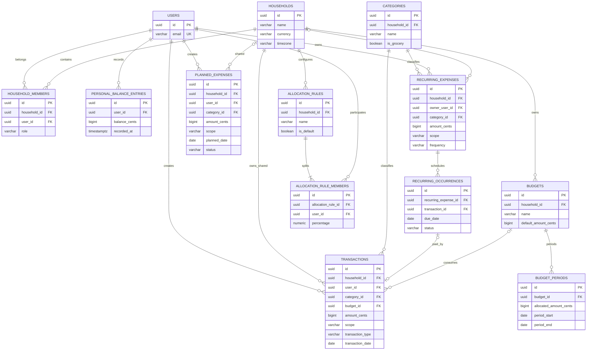

# Diagramme entité-association — Suivi des dépenses

**Version :** 0.4  
**Référence :** DATA_MODEL.md v0.3  
**Statut :** Diagramme conceptuel aligné sur le périmètre fonctionnel

## Diagramme

## Contraintes métier structurantes

1. Le foyer possède deux membres distincts.
2. Le solde suivi est personnel, manuel et historisé ; aucun compte joint n'est modélisé.
3. Une charge récurrente est personnelle ou commune.
4. Une charge commune est répartie par règle par défaut 55/45, ou par règle spécifique totalisant 100 %.
5. Les parts communes restant à payer sont agrégées dans le disponible personnel sous une ligne « Participation au foyer ».
6. Les courses communes sont imputées au budget courses du foyer (490 € par défaut), jamais au disponible personnel.
7. Une occurrence récurrente payée référence une transaction ; une échéance ne peut être générée deux fois.
8. Le disponible prévisionnel ne prend aucun revenu futur en compte.
9. Les sommes sont en centimes entiers et les périodes budgétaires sont mensuelles sans report.
