# Diagramme entité-association — Suivi des dépenses

**Version :** 0.3  
**Statut :** Proposition technique à valider  
**Référence :** `docs/DATA_MODEL.md` v0.2  
**Base cible :** PostgreSQL

Ce diagramme formalise les relations entre les entités métier. Il constitue une proposition de structure relationnelle, pas encore un script SQL ou des modèles SQLAlchemy définitifs.

## 1. Principes de conception retenus

- UUID comme clés primaires et étrangères.
- Montants stockés en centimes entiers (`BIGINT`).
- Les données personnelles sont rattachées à leur propriétaire ; les données communes au foyer.
- Une occurrence récurrente peut produire au maximum une transaction.
- Une règle de répartition peut être la règle par défaut du foyer ou cibler une catégorie, une dépense récurrente ou une transaction ponctuelle.
- Un calcul mensuel est un instantané global qui contient les bases de revenus utilisées, les charges réparties et les montants attribués à chaque membre.
- Les snapshots historiques ne sont jamais recalculés silencieusement.
- Les paramètres de confidentialité sont globaux par utilisateur, indépendamment du foyer auquel il appartient.

## 2. Diagramme global

```mermaid
erDiagram
    USERS {
        uuid id PK
        varchar email UK
        varchar hashed_password
        varchar first_name
        boolean is_active
        timestamptz created_at
        timestamptz updated_at
    }

    HOUSEHOLDS {
        uuid id PK
        varchar name
        varchar currency
        varchar timezone
        timestamptz created_at
        timestamptz updated_at
    }

    HOUSEHOLD_MEMBERS {
        uuid id PK
        uuid household_id FK
        uuid user_id FK
        varchar role
        timestamptz joined_at
        boolean is_active
    }

    FINANCIAL_PRIVACY_SETTINGS {
        uuid id PK
        uuid user_id FK
        boolean share_income_amount
        boolean allow_income_for_allocation
        boolean share_allocation_percentage
        boolean share_allocation_amount
        timestamptz updated_at
    }

    CATEGORIES {
        uuid id PK
        uuid household_id FK
        varchar name
        varchar category_type
        varchar icon
        varchar color
        boolean is_active
    }

    TRANSACTIONS {
        uuid id PK
        uuid household_id FK
        uuid user_id FK
        uuid paid_by_user_id FK
        uuid category_id FK
        uuid original_transaction_id FK
        varchar label
        bigint amount_cents
        varchar transaction_type
        varchar scope
        date transaction_date
        varchar payment_method
        text notes
        timestamptz created_at
        timestamptz updated_at
        timestamptz deleted_at
    }

    BUDGETS {
        uuid id PK
        uuid household_id FK
        uuid user_id FK
        uuid category_id FK
        varchar name
        varchar scope
        varchar budget_type
        bigint default_amount_cents
        boolean is_active
    }

    BUDGET_PERIODS {
        uuid id PK
        uuid budget_id FK
        date period_start
        date period_end
        bigint allocated_amount_cents
        varchar status
    }

    RECURRING_EXPENSES {
        uuid id PK
        uuid household_id FK
        uuid user_id FK
        uuid category_id FK
        varchar label
        bigint amount_cents
        varchar scope
        varchar frequency
        date start_date
        date end_date
        smallint day_of_month
        boolean amount_confirmation_required
        boolean is_active
    }

    RECURRING_OCCURRENCES {
        uuid id PK
        uuid recurring_expense_id FK
        uuid transaction_id FK
        date period_date
        bigint expected_amount_cents
        bigint confirmed_amount_cents
        varchar status
    }

    INCOMES {
        uuid id PK
        uuid household_id FK
        uuid user_id FK
        varchar label
        bigint amount_cents
        varchar income_type
        varchar scope
        date period_start
        date period_end
    }

    ALLOCATION_RULES {
        uuid id PK
        uuid household_id FK
        varchar name
        varchar calculation_method
        date effective_from
        date effective_until
        boolean is_active
    }

    ALLOCATION_RULE_TARGETS {
        uuid id PK
        uuid allocation_rule_id FK
        uuid category_id FK
        uuid recurring_expense_id FK
        uuid transaction_id FK
    }

    ALLOCATION_RULE_MEMBERS {
        uuid id PK
        uuid allocation_rule_id FK
        uuid user_id FK
        numeric percentage_basis
    }

    ALLOCATION_RUNS {
        uuid id PK
        uuid household_id FK
        date period_start
        date period_end
        bigint total_income_cents
        varchar calculation_status
        jsonb calculation_snapshot
        timestamptz created_at
    }

    ALLOCATION_INCOME_SNAPSHOTS {
        uuid id PK
        uuid allocation_run_id FK
        uuid user_id FK
        bigint income_basis_cents
        numeric percentage_basis
    }

    ALLOCATION_CHARGES {
        uuid id PK
        uuid allocation_run_id FK
        uuid transaction_id FK
        uuid allocation_rule_id FK
        uuid recurring_occurrence_id FK
        varchar source_type
        varchar label
        date due_date
        bigint amount_cents
        varchar calculation_method
    }

    ALLOCATION_ITEMS {
        uuid id PK
        uuid allocation_charge_id FK
        uuid user_id FK
        numeric percentage_basis
        bigint allocated_amount_cents
    }

    NOTIFICATIONS {
        uuid id PK
        uuid user_id FK
        uuid household_id FK
        varchar notification_type
        varchar title
        text message
        boolean is_read
        timestamptz created_at
        timestamptz read_at
    }

    NOTIFICATION_PREFERENCES {
        uuid id PK
        uuid user_id FK
        varchar notification_type
        boolean in_app_enabled
        boolean push_enabled
    }

    IMPORT_BATCHES {
        uuid id PK
        uuid user_id FK
        uuid household_id FK
        varchar filename
        varchar file_type
        varchar status
        integer imported_rows
        integer rejected_rows
        timestamptz created_at
    }

    EXPORT_JOBS {
        uuid id PK
        uuid user_id FK
        varchar export_type
        varchar file_type
        varchar status
        timestamptz created_at
        timestamptz expires_at
    }

    AUDIT_LOGS {
        uuid id PK
        uuid user_id FK
        uuid household_id FK
        varchar entity_type
        uuid entity_id
        varchar action
        timestamptz created_at
    }

    USERS ||--o{ HOUSEHOLD_MEMBERS : "appartient"
    HOUSEHOLDS ||--o{ HOUSEHOLD_MEMBERS : "regroupe"
    USERS ||--o| FINANCIAL_PRIVACY_SETTINGS : "configure"

    HOUSEHOLDS o|--o{ CATEGORIES : "possède"
    HOUSEHOLDS o|--o{ TRANSACTIONS : "centralise"
    USERS ||--o{ TRANSACTIONS : "crée"
    USERS o|--o{ TRANSACTIONS : "paie"
    CATEGORIES ||--o{ TRANSACTIONS : "classe"

    HOUSEHOLDS o|--o{ BUDGETS : "possède"
    USERS o|--o{ BUDGETS : "possède"
    CATEGORIES o|--o{ BUDGETS : "catégorise"
    BUDGETS ||--o{ BUDGET_PERIODS : "décline"

    HOUSEHOLDS o|--o{ RECURRING_EXPENSES : "possède"
    USERS ||--o{ RECURRING_EXPENSES : "possède"
    CATEGORIES ||--o{ RECURRING_EXPENSES : "classe"
    RECURRING_EXPENSES ||--o{ RECURRING_OCCURRENCES : "génère"
    TRANSACTIONS o|--o| RECURRING_OCCURRENCES : "matérialise"

    HOUSEHOLDS ||--o{ INCOMES : "comptabilise"
    USERS o|--o{ INCOMES : "déclare"

    HOUSEHOLDS ||--o{ ALLOCATION_RULES : "définit"
    ALLOCATION_RULES ||--o{ ALLOCATION_RULE_TARGETS : "cible"
    CATEGORIES o|--o{ ALLOCATION_RULE_TARGETS : "cible catégorie"
    RECURRING_EXPENSES o|--o{ ALLOCATION_RULE_TARGETS : "cible récurrence"
    TRANSACTIONS o|--o{ ALLOCATION_RULE_TARGETS : "cible dépense"
    ALLOCATION_RULES ||--o{ ALLOCATION_RULE_MEMBERS : "définit les parts"
    USERS ||--o{ ALLOCATION_RULE_MEMBERS : "bénéficie"

    HOUSEHOLDS ||--o{ ALLOCATION_RUNS : "calcule"
    ALLOCATION_RUNS ||--o{ ALLOCATION_INCOME_SNAPSHOTS : "fige les revenus"
    USERS ||--o{ ALLOCATION_INCOME_SNAPSHOTS : "concerne"
    ALLOCATION_RUNS ||--o{ ALLOCATION_CHARGES : "regroupe"
    TRANSACTIONS o|--o{ ALLOCATION_CHARGES : "charge réelle"
    RECURRING_OCCURRENCES o|--o{ ALLOCATION_CHARGES : "charge prévisionnelle"
    ALLOCATION_RULES o|--o{ ALLOCATION_CHARGES : "règle appliquée"
    ALLOCATION_CHARGES ||--o{ ALLOCATION_ITEMS : "ventile"
    USERS ||--o{ ALLOCATION_ITEMS : "reçoit une part"

    USERS ||--o{ NOTIFICATIONS : "reçoit"
    HOUSEHOLDS o|--o{ NOTIFICATIONS : "contexte"
    USERS ||--o{ NOTIFICATION_PREFERENCES : "configure"
    USERS ||--o{ IMPORT_BATCHES : "importe"
    HOUSEHOLDS o|--o{ IMPORT_BATCHES : "cible"
    USERS ||--o{ EXPORT_JOBS : "exporte"
    USERS o|--o{ AUDIT_LOGS : "déclenche"
    HOUSEHOLDS o|--o{ AUDIT_LOGS : "contexte"
```

## 3. Lecture des relations importantes

### 3.1 Utilisateurs et foyer

- Un utilisateur peut appartenir à un ou plusieurs foyers à terme ; la V1 n'en utilise qu'un.
- L'appartenance passe par `household_members`, qui porte le rôle et l'état d'activité.
- Les paramètres de confidentialité sont globaux par utilisateur : un même réglage s'applique quel que soit le foyer auquel la personne appartient.

### 3.2 Transactions et périmètres

- Une transaction personnelle appartient à un utilisateur et n'a pas de foyer.
- Une transaction commune appartient à un foyer ; `user_id` désigne son créateur et `paid_by_user_id` son payeur effectif.
- Une catégorie système peut avoir `household_id = NULL`. Une catégorie personnalisée est rattachée à un foyer.
- Les contraintes garantissant la cohérence entre `scope`, `household_id` et `user_id` devront être implémentées en base lorsque possible, puis vérifiées dans les services.

### 3.3 Budgets et périodes

- Un budget possède soit un `user_id`, soit un `household_id`, jamais les deux.
- Un budget contient plusieurs périodes mensuelles.
- Une période fige le montant de l'enveloppe applicable au mois.
- Les transactions éligibles sont agrégées pour calculer le consommé ; elles ne sont pas dupliquées dans les tables de budget.
- Il n'existe aucune relation de report entre deux périodes.

### 3.4 Dépenses récurrentes

- Une définition récurrente génère des occurrences datées.
- Une occurrence peut ne pas produire de transaction (en attente, ignorée ou non payée).
- Une occurrence peut servir de source à une charge prévisionnelle avant paiement.
- Une occurrence payée référence une transaction unique.
- La relation est portée uniquement par `recurring_occurrences.transaction_id`. Le champ inverse `transactions.recurring_occurrence_id` du modèle v0.2 est à supprimer pour éviter une FK circulaire.
- Contrainte recommandée : `UNIQUE(transaction_id)` sur `recurring_occurrences`, en plus de `UNIQUE(recurring_expense_id, period_date)`.

### 3.5 Revenus

La table `incomes` représente les montants déclarés servant de base aux calculs (salaire, aide, autre), avec une période de validité. Une transaction de type `income` représente un mouvement financier réellement enregistré dans le suivi des transactions.

Ces deux notions ne doivent pas être additionnées automatiquement : un revenu déclaré peut correspondre à une ou plusieurs transactions réelles, ou être utilisé uniquement comme base de répartition. Une relation explicite entre les deux sera à ajouter seulement si le besoin de rapprochement est confirmé.

### 3.6 Règles de répartition

- Une règle appartient à un foyer.
- Une règle sans cible dans `allocation_rule_targets` est une règle par défaut du foyer.
- Une règle ciblée peut viser une catégorie, une dépense récurrente ou une transaction ponctuelle.
- Chaque ligne de cible doit renseigner exactement une des trois FK. Une contrainte CHECK doit l'imposer.
- Les règles personnalisées ont une ligne par membre dans `allocation_rule_members`, avec une somme des pourcentages égale à 100 %.
- Les règles doivent avoir des périodes d'effet non ambiguës. La résolution de priorité entre règle ciblée et règle par défaut est définie dans les services métier.

### 3.7 Calculs mensuels et historique

Le calcul est modélisé comme un lot mensuel :

1. `allocation_runs` représente le calcul d'un foyer sur une période.
2. `allocation_income_snapshots` conserve la base de revenu admissible par membre, sans obliger à exposer les revenus privés.
3. `allocation_charges` représente chaque charge répartie, réelle ou prévisionnelle, et conserve la règle effectivement appliquée. Une charge réelle référence une transaction ; une charge prévisionnelle peut référencer une occurrence récurrente ou être saisie manuellement.
4. `allocation_items` conserve la part calculée pour chaque membre et chaque charge.

Cette granularité permet d'appliquer plusieurs règles au cours d'un même mois. Une charge porte un `source_type` (`actual_transaction`, `recurring_occurrence` ou `manual_forecast`). Une contrainte CHECK garantit la cohérence des références de source.

Un seul calcul définitif est conservé par foyer et par période. Une fois finalisé, le calcul et ses lignes sont immuables. Toute correction doit être explicite et auditée. Cette structure remplace la relation trop restrictive `monthly_allocations.allocation_rule_id` du modèle v0.2.

Les snapshots contenant des données financières sensibles nécessitent des autorisations de lecture strictes. Le JSONB ne doit pas devenir un moyen de contourner les règles de confidentialité.

## 4. Contraintes SQL à prévoir

| Entité | Contrainte recommandée |
|---|---|
| `household_members` | UNIQUE (`household_id`, `user_id`) |
| `financial_privacy_settings` | UNIQUE (`user_id`) |
| `transactions` | `amount_cents > 0` ; `original_transaction_id` est renseigné uniquement pour un remboursement et référence la dépense d'origine |
| `budgets` | exactement un propriétaire : `household_id` ou `user_id` |
| `budget_periods` | UNIQUE (`budget_id`, `period_start`) ; `period_end >= period_start` |
| `recurring_occurrences` | UNIQUE (`recurring_expense_id`, `period_date`) ; UNIQUE (`transaction_id`) |
| `incomes` | personnel = `user_id` non NULL ; foyer = `user_id` NULL |
| `allocation_rule_members` | UNIQUE (`allocation_rule_id`, `user_id`) |
| `allocation_rule_targets` | exactement une cible renseignée |
| `allocation_runs` | UNIQUE (`household_id`, `period_start`, `period_end`) si un seul calcul final est conservé par période |
| `allocation_income_snapshots` | UNIQUE (`allocation_run_id`, `user_id`) |
| `allocation_charges` | UNIQUE (`allocation_run_id`, `transaction_id`) lorsque non NULL ; source cohérente avec `source_type` ; montant positif |
| `allocation_items` | UNIQUE (`allocation_charge_id`, `user_id`) |
| `notification_preferences` | UNIQUE (`user_id`, `notification_type`) |

Les contraintes portant sur plusieurs lignes (somme des pourcentages, absence de chevauchement des périodes de règles) nécessitent une validation transactionnelle ou des mécanismes PostgreSQL adaptés. Une simple contrainte CHECK ne suffit pas.

## 5. Écarts par rapport à DATA_MODEL.md v0.2

| Sujet | Proposition ERD | Motif |
|---|---|---|
| Nombre de tables | 21 entités dans le diagramme | Le décompte annoncé dans v0.2 doit être corrigé : le document liste en réalité 20 tables. L'ERD ajoute une table de cibles explicites et remodèle les calculs mensuels. |
| Lien occurrence / transaction | FK uniquement sur l'occurrence | Évite une relation circulaire. |
| Cibles de règles | Table `allocation_rule_targets` avec FK explicites | Préserve l'intégrité référentielle sans FK polymorphe. |
| Calcul mensuel | `allocation_runs`, snapshots de revenus, charges et parts | Permet plusieurs règles et plusieurs charges dans le même calcul. |
| Revenu déclaré et transaction de revenu | Deux notions séparées | Évite le double comptage et clarifie la base de calcul. |
| Fréquence semestrielle | Valeur `semiannual` à ajouter au modèle | Alignement avec les spécifications fonctionnelles. |

> Le nombre de 21 entités correspond au diagramme proposé, après ajout de `allocation_rule_targets` et remplacement des deux tables de calcul v0.2 par quatre tables. Ce comptage devra être revérifié à la création du schéma SQL.

## 6. Décisions fonctionnelles validées

1. **Calcul mensuel :** une seule version définitive par foyer et par mois.
2. **Charges réparties :** charges réelles et prévisionnelles. Une prévision peut provenir d'une occurrence récurrente ou être saisie manuellement.
3. **Priorité des règles :** transaction ponctuelle, dépense récurrente, catégorie, puis règle générale du foyer.
4. **Remboursements :** transaction distincte reliée à la dépense d'origine par `original_transaction_id`. Plusieurs remboursements partiels peuvent référencer la même dépense.
5. **Revenus :** uniquement une base de calcul des répartitions, pas une prévision de trésorerie.
6. **Confidentialité :** réglages globaux par utilisateur, indépendamment du foyer.

---

**Fin — ERD.md v0.3**
